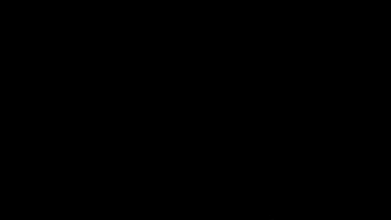

# Antigravity Custom Theme Skill

Turn a wallpaper or color palette into a live theme for **Antigravity**. The project includes a local theme engine, a browser Dashboard, a Windows tray, and an **AI Agent Skill** (`SKILL.md`).

> Give your AI agent an image + vibe ("cosmic violin gold on deep midnight", "cozy Kyoto matcha", "cyberpunk neon cyan"), and let it extract the palette, stage assets, compile the payload, and hot-reload your Antigravity UI cleanly without touching Electron app binaries.



## Features

- **Zero Live Blur:** Uses pre-baked canvas glass (`syncPrebakedGlass`) and gradient scrims instead of live backdrop blur in Antigravity scroll areas.
- **Unified L-Glass + Split-Browser Safe:** Automatically detects Antigravity's split embedded Chromium view (`data-has-browser-hole`) and cuts an `evenodd` `clip-path` window so embedded pages never get tinted or blurred.
- **Live Settings Modal:** Switch presets, upload custom wallpapers or **User / AI Agent circular avatars** (auto-compressed WebP), adjust scrim darkness, and persist choices to `theme_config.json`.
- **Light & Dark Glass Modes:** Supports both deep dark themes and daytime bright palettes (`isLight: true`) with adaptive ink, frosted pills, and titlebar controls.
- **Built-In Sample Presets:**
  - `WLOP Cosmic` — 2K starlight wallpaper + custom SVG flourishes (`themes/assets/wlop_cosmic_2k.webp`)
  - `Midnight Obsidian` — Ultra-light zero-image pure-CSS gradient preset
  - `Gemini-chan Live` and `Furina Live` — muted, looping video wallpapers with static posters
- **Media Library & Effects:** Preview and reuse local images, videos, and task completion sounds. Replay the Starfield Boot HUD or Sketch Reveal, and customize the greeting in an empty chat.
- **Data/Engine Separation:** Add your own themes solely inside `themes/themes.json` + `themes/assets/` and compile via `scripts/build_payload.py`.
- **Cross-Platform Daemon (`daemon/theme_daemon.js`):** Windows, macOS, and Linux support using Node >= 22 built-in `WebSocket`.

## Prerequisites

- **Antigravity** with a local debugging port (`DevToolsActivePort`) to apply a theme. The Dashboard and build can run with Antigravity closed.
- **Node.js >= 22** (uses native `globalThis.WebSocket`, zero `npm install` needed)
- **Python 3.10+**. Install `python -m pip install -r requirements.txt` for image design and WebP optimization. Building without Pillow embeds existing rasters unchanged.

## Quick Start

### 1. Build the Runtime Payload

```bash
python scripts/build_payload.py
```

This resolves `themes/themes.json` + `themes/assets/*` and compiles them with `engine/core.js` into gitignored `dist/theme_payload.js`.

For private presets, first duplicate `themes/themes.json` as `themes/themes.local.json` if it does not already exist. The daemon and both Python CLIs prefer that catalog. For a shared build use `python scripts/build_payload.py --themes themes/themes.json`. After selecting a different catalog, rebuild and restart the daemon. Do not commit artwork without redistribution rights.

The daemon rebuilds the payload on startup when the compiler, engine, or preset catalog is newer. The Dashboard marks a preset as in use only after Antigravity confirms it.

### 2. Install & Run the Daemon

**Windows (PowerShell):**

```powershell
powershell -ExecutionPolicy Bypass -File scripts/install-win.ps1
```

Configures Startup (`AntigravityCustomTheme.lnk`) and patches Antigravity shortcuts. `-NoStartup` skips Startup registration, not the CDP flag patch. For a foreground Dashboard without modifying shortcuts, run `node daemon/theme_daemon.js` and open `http://127.0.0.1:47990` or the port in `daemon.webport`. On Windows, `powershell -NoProfile -ExecutionPolicy Bypass -File scripts/start-all.ps1 -OpenDashboard` also starts the tray.

**macOS / Linux (Bash):**

```bash
bash scripts/install-unix.sh
```

- On **macOS**, installs a `~/Library/LaunchAgents/io.antigravity.custom-theme.plist` LaunchAgent.
- On **Linux**, installs a `systemd --user` service (or falls back to `nohup`).
- Use `bash scripts/install-unix.sh --foreground` to run interactively in your terminal, or `stop` / `status`.

> CI checks the build and local integration without installing an OS service or connecting to Antigravity. Use `AGY_PORT_FILE` to override the `DevToolsActivePort` path. If your Unix system has only `python3`, set `PYTHON_PATH=python3` in the daemon's environment.

### 3. Verify Live via CDP

```bash
node scripts/verify_cdp.js
```

### Customize media and effects

The Dashboard shows a poster for each local wallpaper, including video presets. Videos play in Antigravity, not in the preset grid. Open **Custom theme** in Antigravity to choose **Static image** or **Video** under **Wallpaper source**, add a file, preview it, then select **Use wallpaper**. **Use preset** switches back without deleting uploads from `themes/user_media/`.

Open **Motion and greetings** to enable or replay Boot HUD and Sketch Reveal, or save a list of greetings (one per line). Boot HUD plays one of four bundled Tawa clips when the renderer allows audio. When your system requests reduced motion, video wallpapers show the preset poster, and automatic Boot HUD and Sketch Reveal stay off.

Under **Task voice**, set the volume and enable playback. The studio picks from your uploads when a task finishes; without uploads, it uses the bundled Tawa sample. If no voice can play, it uses the existing completion ping. **Sound Effects** mutes automatic audio. Uploads are limited to 25 MB per file and stay on this machine.

### Design a theme from a wallpaper

In Theme Studio, choose a wallpaper and **Xem trước** to preview the palette, crop, and chat surfaces. The active theme stays unchanged until **Lưu và chọn theme**. The local palette option uses Pillow and works offline.

Vision selects the subject, rotation, bubble treatment, composer style, and a small matching ornament. The renderer builds an actual 16:9 WebP; narrow artwork uses a sharp subject area and a pre-blurred extension. **Hướng wallpaper** overrides rotation and can reframe a preview without another model call. The preview and Antigravity use the same rendered assets.

Open **Cấu hình AI** in the image section. Enter the full OpenAI-compatible Chat Completions URL, a model that accepts `image_url`, and an API key if required. **Điền mẫu 9Router** fills the local URL and a sample model ID. Remote URLs must use HTTPS and credentials belong in the API key field, not in the URL.

**Lưu cấu hình** takes effect without restarting the daemon. Settings are stored in your user profile (`%LOCALAPPDATA%\AntigravityTheme\vision.json` on Windows, `~/.antigravity-theme/vision.json` elsewhere), outside the repository. The key is stored locally without encryption and never returned to the Dashboard. Leave it blank to keep the key for the same URL, or select **Bỏ API key đã lưu** to remove it.

`AGY_VISION_URL`, `AGY_VISION_MODEL`, and the optional `AGY_VISION_API_KEY` remain a fallback when there are no saved Dashboard settings.

Once configured, AI is the default for new previews. You can still select **Phối màu tại máy**. Only clicking **Xem trước với AI** sends a resized JPEG to the configured endpoint. Saving reuses the validated design tokens without a second model call. The original wallpaper stays local.

The default avatar is cropped around the subject. To redraw it, set **Model tạo avatar** to an image-to-image model on the same router and enable **Tạo avatar bằng model ảnh** before previewing. The router must accept a reference `image` at `/v1/images/generations` and return inline `b64_json`. This sends the cropped square as a second, separate request. If the model fails, the preview labels the fallback as a crop. The avatar is saved as the preset's agent avatar; manual avatar overrides in Antigravity are preserved.

### 4. Uninstall Cleanly

```bash
node scripts/uninstall.js
```

Stops the daemon, removes its auto-start registration, and attempts to clear the theme from open renderers. On Windows, run `powershell -NoProfile -ExecutionPolicy Bypass -File scripts/setup-autostart.ps1 -Restore` before uninstalling to restore backed-up Desktop and Start Menu shortcuts; review any customized taskbar pin separately. Use the tray's **Exit** menu if it is running.

## Troubleshooting: Theme Disappeared After an Antigravity Update

Starting with **Antigravity v2.33.0+**, Antigravity no longer creates `DevToolsActivePort` by default unless launched with `--remote-debugging-port=0`, and the built-in auto-updater restarts `Antigravity.exe --updated` without shortcut flags.

- **Windows:**
  1. Re-run `powershell -ExecutionPolicy Bypass -File scripts/install-win.ps1` (it automatically patches `--remote-debugging-port=0` onto your `Antigravity.lnk` shortcuts in Start Menu, Desktop, Startup, and Taskbar).
  2. **Quit Antigravity completely** (right-click the System Tray icon -> **Quit**) and reopen it from the **Start Menu**.
  3. If you use a **Taskbar pin**, **Unpin** the old icon and re-pin it from the Start Menu `Antigravity` shortcut so the `--remote-debugging-port=0` flag is preserved.
- **macOS / Linux:**
  - Start Antigravity with `--remote-debugging-port=0` (`open -a Antigravity --args --remote-debugging-port=0` on macOS, or append `--remote-debugging-port=0` to the `Exec=` command in your `.desktop` entry on Linux).

## Use as an Antigravity Skill (`SKILL.md`)

Copy or clone this repository into either:

- **Global skill directory:** `~/.gemini/config/skills/antigravity-custom-theme/`
- **Workspace skill directory:** `.agents/skills/antigravity-custom-theme/`

Once installed, simply prompt your Antigravity agent with an image and aesthetic preference (e.g., *"Use `antigravity-custom-theme` to build me a dark emerald studio Ghibli theme from this image"*). The agent reads `SKILL.md` + `references/theme-schema.md`, creates your preset in `themes/`, builds `dist/theme_payload.js`, and verifies it via `verify_cdp.js`.

## Development

- [Architecture](ARCHITECTURE.md): compiler, renderer, daemon, Dashboard, and platform launchers.
- [Contributing](CONTRIBUTING.md): pinned environment, test commands, and PR process.
- [Release readiness](docs/REPOSITORY_AUDIT.md): publication checks and Git commands.
- [Changelog](CHANGELOG.md) and [security/privacy guidance](SECURITY.md).

## License

The code is distributed under the existing [MIT license](LICENSE).

## Upstream Credits

- [Antigravity Custom Theme Skill](https://github.com/giakiet22102006/antigravity-custom-theme-skill) by [@giakiet22102006](https://github.com/giakiet22102006): original skill and theme engine.
- [Antigravity Custom Theme Mod](https://github.com/furinamikuvn/antigravity-custom-theme-mod) by [@furinamikuvn](https://github.com/furinamikuvn): additional theme and renderer work, including the [live presets, Boot HUD artwork and voices, sample task voice, and demo](https://github.com/furinamikuvn/antigravity-custom-theme-mod/tree/b74ac04a30bad3eb741014935c350f4aa391e123).

Both upstreams use MIT for the code. Attribution does not establish redistribution rights for artwork or audio. The bundled Mali font is distributed under the [SIL Open Font License](themes/assets/fonts/OFL-Mali.txt).
